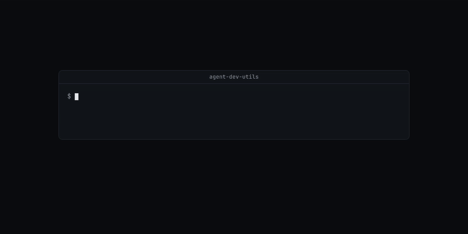

# agent-dev-utils

*A junk drawer for the agent age. Every tool in here was born at 3 a.m. to kill one specific annoyance.*

Small standalone scripts for a developer who runs coding agents on Linux or WSL: cleanup, git worktree repair, browser automation over CDP, cookie extraction, model and deployment helpers.



## Why

Each script fixes one problem that came up while running agents on one machine. Agent browser sessions that end without closing leave headless Chrome running. One case was 75 processes using 7.2 GB that pushed WSL to 20 of its 22 GB (`browser-reap`). A git worktree seeded with a symlink to another checkout's `node_modules` builds against that checkout's workspace packages (`worktree-relink`). `opencode` gives up on the `models.dev` download and keeps a stale model list (`opencode-models-refresh`). The scripts share no code. Copy the one you need.

## Install

```bash
git clone <this repository> agent-dev-utils
cd agent-dev-utils
python3 -m pip install -r requirements.txt   # websockets and cryptography, for the Python tools
```

Run a script by path, or put its directory on `PATH`. The Python scripts have no shebang line, so run them with `python3`. Per-tool requirements are listed in each section below.

## Quick start

These two tools change nothing outside the directory you point them at.

List stale browser processes without killing them:

```console
$ browser-reap/browser-reap 60 --dry-run
browser-reap: 0 processes older than 60m, ~0 MB would be freed
```

Repair a worktree whose `node_modules` is a symlink to the main checkout. The fixture below is a pnpm workspace in `/tmp/wt-demo/app` with one package, `@acme/ui`, and a worktree in `/tmp/wt-demo/app-wt` whose `node_modules` links to `/tmp/wt-demo/app/node_modules`:

```console
$ m=node_modules/@acme/ui; realpath $m; worktree-relink . @acme; realpath $m
/tmp/wt-demo/app/packages/ui
relinked 1 node_modules dirs under /tmp/wt-demo/app-wt to its own @acme packages
/tmp/wt-demo/app-wt/packages/ui
```

## Tools

### browser-reap

Kills `agent-browser` Chrome processes, `agent-browser` daemons, and `ffmpeg ... image2pipe` screencast recorders that are older than an age limit. After 2 seconds it sends `kill -9` to any browser or recorder that is still running. Processes younger than the limit are not touched.

```text
browser-reap [max-age-minutes] [--dry-run]     # default age: 60
```

Needs bash and `ps`. It matches browsers by `.agent-browser/browsers` in the command line.

### worktree-relink

Turns every symlinked top-level `node_modules` under a worktree into a real directory. Links to packages in the given workspace scope point at the worktree's own packages. Other entries stay links to the original checkout. pnpm task state and Vite caches (`.pnpm-task-run-state-v1`, `.vite`, `.vite-temp`) become empty per-worktree directories. `.bin` and `.pnpm-workspace-state-v1.json` are copied.

```text
worktree-relink <worktree> <workspace-scope>    # for example: worktree-relink ../app-wt @acme
```

Needs bash and GNU coreutils. Written for pnpm workspaces.

### opencode-models-refresh

Downloads `https://models.dev/api.json` with a 300-second timeout, checks that it parses and has an `opencode` key, and replaces `~/.cache/opencode/models.json`. A run on this machine took 8 seconds and wrote 5.96 MB.

```text
opencode-models-refresh
```

Needs `curl` and `python3`.

### helium-cdp-text, helium-cdp-click, helium-fetch, notion-publish-helium

Drive a Chromium-based browser that is already running with remote debugging on `127.0.0.1:9222`. The names refer to the Helium browser, but any browser that serves `/json/version` on that port works. Each script opens its own tab, so it uses the browser's signed-in sessions, and closes the tab at the end.

```text
python3 helium-cdp-text/helium-cdp-text.py <url> [wait_seconds] [js_expression]
python3 helium-cdp-click/helium-cdp-click.py <url> [button-pattern ...]
python3 helium-fetch/helium-fetch.py <origin> <path|wait:seconds|js:expression> [...]
python3 notion-publish-helium/notion-publish-helium.py <notion-page-url>
```

- `helium-cdp-text` opens a background tab, waits (default 8 seconds), and prints the value of a JavaScript expression (default `document.body.innerText`). It turns on focus emulation so throttled pages finish rendering.
- `helium-cdp-click` clicks the last visible button, link or list item whose text matches each regular expression in turn, and prints the page text after each click.
- `helium-fetch` runs `fetch(path, {credentials: 'include'})` from a tab on the origin and prints the status and body. `WAIT` sets the first wait in seconds (default 4).
- `notion-publish-helium` opens a Notion page in a new window, clicks **Share**, then **Publish**, and prints the `notion.site` link.

Need Python 3 and the `websockets` package.

### ft-helium-extract and ft-sync

`ft-helium-extract` copies the browser's cookie database from a Volume Shadow Copy snapshot, decrypts the `ct0` and `auth_token` cookies for `x.com` and `twitter.com`, and saves them to `~/.config/ft-helium/cookies` with mode 600. `ft-sync` reads that file and runs `ft sync --cookies <ct0> <auth_token>`. See [How it works](#how-it-works).

```text
HELIUM_PROFILE_DIR='C:\Users\<you>\AppData\Local\...\User Data\Default' ft-helium-extract/ft-helium-extract
ft-sync/ft-sync [ft sync options]
```

`ft-helium-extract` needs WSL, Windows PowerShell, an administrator account for the UAC prompt, and the Python `cryptography` package. The profile must be on drive `C:`. `ft-sync` needs the `ft` command on `PATH`.

### t3-overlay

Waits until `T3 Code (Nightly).exe` has exited (up to 24 hours), runs `scripts/install-local-windows-bundle.cjs` from a T3 Code checkout to overlay a local build onto the Windows install, checks `server.asar` for two markers, and starts the app again.

```text
t3-overlay/t3-overlay-now.sh <bundle-checkout> <windows-resources-dir> <linux-cli-archive>
```

Needs WSL, Node.js, and a T3 Code checkout that has that installer script. The paths can come from `config.example.sh` instead of arguments.

### t3-staging-tools

`resolve.py` replaces one git conflict hunk in a file with our side, their side, both sides, or the contents of a text file. Hunks are numbered from 0. It also handles diff3 conflicts. `notify-windows.sh` shows a Windows toast notification from WSL and never fails.

```text
python3 t3-staging-tools/resolve.py FILE IDX ours|theirs|both|text [TEXTFILE]
t3-staging-tools/notify-windows.sh <title> <body>
```

A run on a file with one hunk:

```console
$ printf 'a\n<<<<<<< HEAD\nours line\n=======\ntheirs line\n>>>>>>> feature\nb\n' > c2.txt
$ python3 t3-staging-tools/resolve.py c2.txt 0 both; cat c2.txt
a
ours line
theirs line
b
```

`resolve.py` needs Python 3. `notify-windows.sh` needs WSL and `powershell.exe`.

### wallet-diag

Read-only scripts that check a crypto wallet through public RPC endpoints. They never sign or broadcast.

```text
node wallet-diag/wallet-diag.mjs <0x-address> [bsc|ethereum|polygon]
MN='<mnemonic>' node wallet-diag/derive-and-diag.mjs
MN='<mnemonic>' node wallet-diag/tron-check.mjs
MN='<mnemonic>' node wallet-diag/tron-perms-and-derive.mjs <tron-address>
node wallet-diag/tron-history.mjs <tron-address>
node wallet-diag/tron-sweep-check.mjs <tron-address>
```

`wallet-diag.mjs` prints the native balance, the balances of two or three stablecoins per chain, the token approvals from the last 4,900 blocks, and a short reading of the result:

```console
$ node wallet-diag/wallet-diag.mjs 0x000000000000000000000000000000000000dEaD ethereum

=== Ethereum | 0x000000000000000000000000000000000000dEaD ===

Native ETH (gas): 12642.702513725780250421

Tokens:
  USDT  26997.832786
  USDC  57469.542527
  DAI   7746.209639451449990033

Recent approvals you granted (possible drainers):
  (none in scanned window)

--- READ ---
There is gas AND tokens → a normal Send SHOULD work. If it doesn't, the block is
elsewhere (approval lock / wrong network selected / spoof token). Check approvals above.
```

The `MN` scripts derive addresses from a mnemonic on your machine. The mnemonic is a full wallet secret, so run them only on a machine you trust. `wallet-diag.mjs` and the two history scripts need only Node.js 18 or later. The others need `ethers` (`cd wallet-diag && npm install`). The Tron scripts call `api.trongrid.io`.

### i2m

Wrappers that run four image-to-3D and image-to-pose models on one RGBA drawing and render each result with Blender: Hunyuan3D-2 (mini-turbo shape, then paint-turbo texture), TripoSG, InstantMesh and Talking Head Anime 3. Each step in `run-all.sh` writes a marker to `done/`, so a rerun after a crash skips the finished steps.

```text
i2m/setup-cuda.sh       # CUDA 12.8 toolkit through apt (sudo -n)
i2m/setup-venv.sh       # venv with torch cu128 and Hunyuan3D-2 requirements; resumes the cusolver wheel
i2m/setup-venv-im.sh    # separate venv for InstantMesh
i2m/setup-weights.sh    # about 27 GB of weights from Hugging Face into weights/
i2m/run-all.sh          # every model on I2M_INPUT
i2m/launch.sh           # setup-venv-im.sh and waiter.sh as systemd user units
```

`waiter.sh` waits for `VENV-DONE` in `logs/venv.log`, runs `run-all.sh`, then runs it again after CUDA and all weights are in place. `hy-run.py` keeps the shape and paint pipelines out of GPU memory at the same time so Hunyuan3D-2 fits on one 8 GB GPU.

Needs an NVIDIA GPU, `uv`, `uvx`, Blender at `~/.local/bin/blender`, a Blender render script of your own, and the upstream checkouts `Hunyuan3D-2`, `TripoSG`, `InstantMesh` and `talking-head-anime-3-demo` under `I2M_ROOT`. Read [i2m/NOTICE](i2m/NOTICE) before you download any model.

### railway-light-proxy

A password-protected HTTP proxy on Railway. The `Dockerfile` runs `ginuerzh/gost:2.12.0` as `gost -L=http://$PROXY_USER:$PROXY_PASS@:$PORT`. The scripts deploy it, check it, move its region, and manage its TCP proxy through the Railway CLI and GraphQL API.

| Script | What it does |
| --- | --- |
| `deploy.sh` | Sets `PROXY_USER`, `PROXY_PASS` and `PORT=8080` on the `proxy` service and runs `railway up`. |
| `check.sh` | Prints service status and logs, then fetches `https://ifconfig.me` through the proxy. |
| `test-tcp-proxy.sh` | Prints the TCP proxies and compares your direct IP with the proxy IP. |
| `fix-profile.sh` | Writes `RAILWAY_PROXY_URL` to `~/.profile`. |
| `create-tcp-proxy.sh`, `try-create-tcp.sh` | Create a TCP proxy to port 8080. |
| `move-us-east.sh`, `restore-europe.sh`, `fix-single-region.sh` | Change the service region and redeploy. |
| `query-*.sh`, `mutations.sh`, `schema-tcp.sh`, `types-tcp.sh`, `print-tcp-type.sh`, `railway-gql-test.sh`, `grep-railway.sh` | Read the Railway GraphQL schema and the current TCP proxies. |

Needs the `railway` CLI (logged in, or `RAILWAY_TOKEN`), `curl` and `jq`. Every script accepts `--help`.

### ida-scripts

PowerShell scripts that keep the `ida-pro-mcp` HTTP server running on `127.0.0.1:13337` for IDA Pro on Windows.

| Script | What it does |
| --- | --- |
| `start.ps1` | Finds `IDADIR` and `idalib-mcp`, reuses a healthy server or starts a logged supervisor, and prints `OK:<tool_count>` or `ERR:...`. |
| `watchdog.ps1` | One health check. Starts the server if it is down and replaces it if `tools/list` has failed for 3 minutes. |
| `install-autostart.ps1` | Registers a scheduled task that runs `watchdog.ps1` at logon and every minute. `-Unregister` removes it. |
| `recover.ps1` | Restarts the managed supervisor. It never kills `ida.exe`. |
| `start-gui.ps1` | Starts the IDA GUI so its MCP plugin serves HTTP. Use it when headless idalib cannot get a license. |
| `open.ps1` | Opens a binary through the HTTP API, with a timeout. |
| `run-supervisor.py` | Runs the supervisor without a console and logs to `%LOCALAPPDATA%\reverse-skill\ida-mcp\supervisor.log`. |
| `IdaOpenHelpers.ps1` | Lock rules shared by the other scripts. It never deletes `.i64` or `.idb` files. |

Needs Windows, a licensed IDA Pro, and the `ida-pro-mcp` Python package.

## How it works


The diagram shows `ft-helium-extract` and `ft-sync`, the one flow in this repository that crosses from WSL into Windows and back.

A running Chromium browser locks its `Network\Cookies` file, so a plain copy fails. `ft-helium-extract` writes a PowerShell script to the Windows temp directory and starts it elevated, which shows a UAC prompt. The script creates a `Win32_ShadowCopy` of `C:\`, copies `Network\Cookies` and `Local State` out of the snapshot, decrypts the browser's AES key from `Local State` with DPAPI for the current user, writes the key and the copy's path to a JSON file, and deletes the snapshot.

Back in WSL, an embedded Python script opens the copied SQLite database read-only, selects `ct0` and `auth_token` for the X domains, and decrypts each `v10` or `v11` value with AES-GCM. It writes `name=value` lines to `~/.config/ft-helium/cookies` under `umask 077` and deletes the Windows-side files. Cookie values are never printed. `ft-sync` exits with an error if the file is missing or lacks either cookie.

## Configuration

| Variable | Used by | Default | What it does |
| --- | --- | --- | --- |
| `HELIUM_PROFILE_DIR` | `ft-helium-extract` | required | Windows path of the browser profile, the directory that contains `Network\Cookies`. |
| `FT_COOKIES_FILE` | `ft-sync` | `~/.config/ft-helium/cookies` | Cookie file to read. |
| `WAIT` | `helium-fetch.py` | `4` | Seconds to wait after the tab opens. |
| `MN` | `derive-and-diag.mjs`, `tron-check.mjs`, `tron-perms-and-derive.mjs` | required | Wallet mnemonic. Read from the environment so it does not appear in the process list. |
| `T3_BUNDLE_DIR`, `T3_RESOURCES_DIR`, `T3_CLI_ARCHIVE` | `t3-overlay-now.sh` | required, unless passed as arguments | T3 Code checkout, Windows install `resources` directory, Linux CLI archive. See `t3-overlay/config.example.sh`. |
| `I2M_ROOT` | `i2m/*` | the `i2m` directory | Root that holds the upstream checkouts, venvs, `weights/`, `done/` and `logs/`. |
| `I2M_INPUT`, `I2M_OUTPUT`, `I2M_RENDER_SCRIPT` | `run-all.sh`, `waiter.sh` | required | Input RGBA image, output directory, Blender script that takes a mesh path and an output prefix. See `i2m/config.example.sh`. |
| `PROXY_USER`, `PROXY_PASS`, `PROXY_HOST` | `railway-light-proxy` | required | Proxy credentials and the host and port Railway assigned. Set them in `config.sh`, copied from `config.example.sh`. `config.sh` is git-ignored. |
| `PROXY_CONFIG` | `railway-light-proxy` | `./config.sh` | Path of the config file to source. |
| `RAILWAY_SERVICE_ID`, `RAILWAY_ENVIRONMENT_ID` | `railway-light-proxy` | required by the patch and query scripts | Railway service and environment. |
| `RAILWAY_TOKEN` | `railway-light-proxy` | Railway CLI login | API token for the GraphQL scripts. |
| `RAILWAY_REFERENCE_DIR` | `grep-railway.sh` | required | Local directory of Railway reference files to search. |
| `IDADIR` | `ida-scripts` | found from the registry and common paths | IDA Pro install directory. |

## Limits

- Most tools assume Linux under WSL 2 with Windows next to it. `ft-helium-extract`, `t3-overlay`, `notify-windows.sh` and `ida-scripts` do not work without Windows.
- `ft-helium-extract` decrypts session cookies from your own browser profile. Anyone who can read `~/.config/ft-helium/cookies` can act as your X account.
- Only these were run while this README was written: `--help` for every script, `browser-reap --dry-run`, `worktree-relink` and `resolve.py` on fixtures, `opencode-models-refresh` with a scratch `HOME`, and `wallet-diag.mjs` on a public address. The CDP scripts, cookie extraction, the T3 overlay, the i2m models, the Railway deployment and the IDA scripts were not run.
- `run-all.sh` hard-codes CUDA 12.8 under `/usr/local/cuda-12.8` and `TORCH_CUDA_ARCH_LIST="12.0"`.
- The model code and weights that `i2m` downloads have their own licenses, and some are not MIT. See [i2m/NOTICE](i2m/NOTICE).

## License

MIT for the scripts in this repository. See [LICENSE](LICENSE). Third-party models used by `i2m` keep their own terms, listed in [i2m/NOTICE](i2m/NOTICE).
